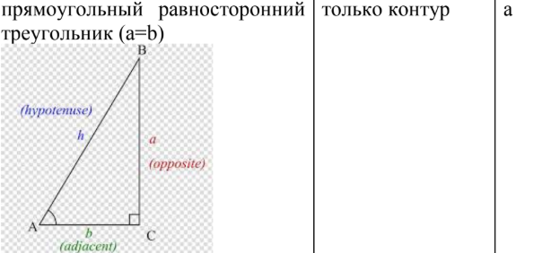
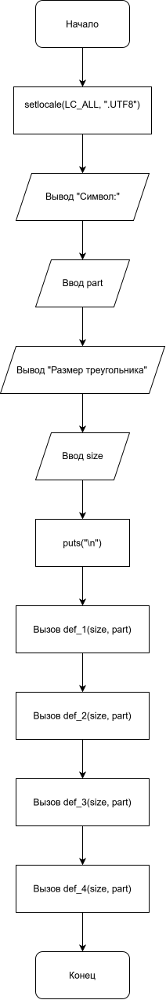
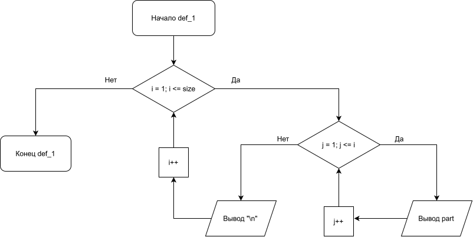
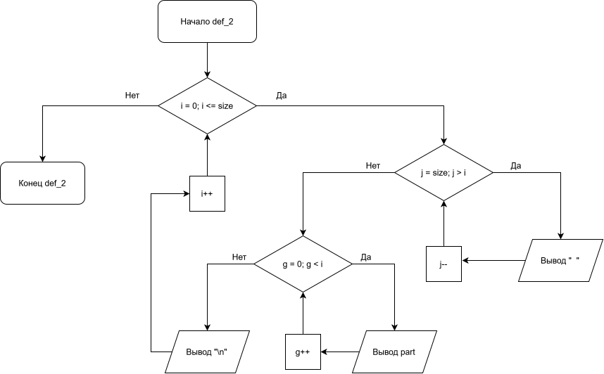
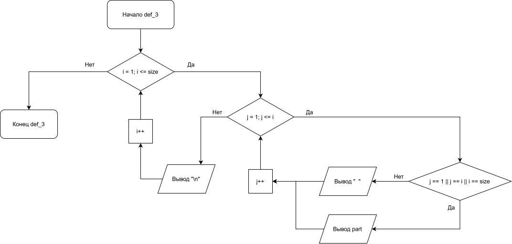
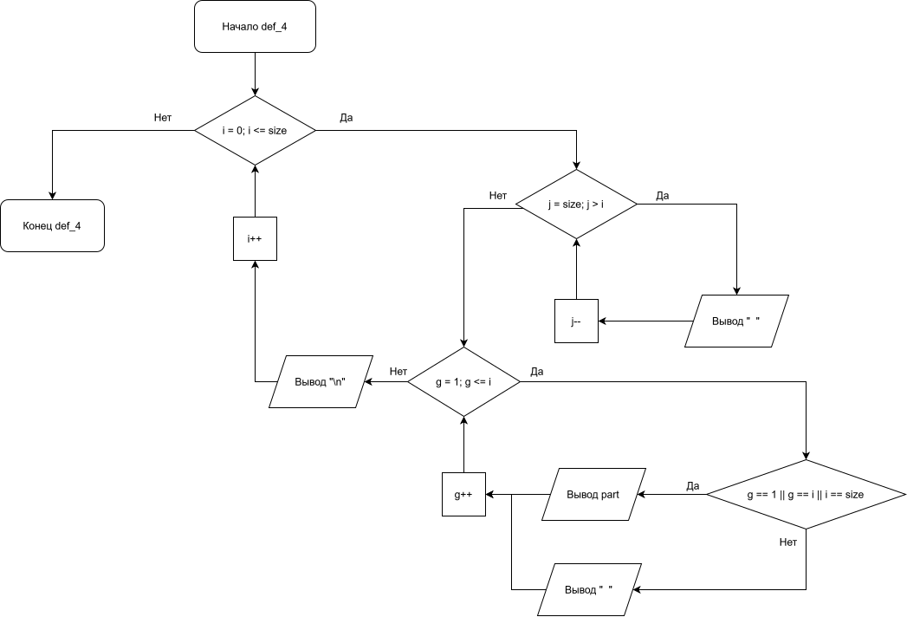

# Лабораторная работа №9
---

## 1. Вариант

**Вариант 5**

---

## 2. Условие задачи



---

## 3. Блок-схема

* **Блок-схема Main:**
  

* **Блок-схема def_1:**
  
  
* **Блок-схема def_2:**
  
  
* **Блок-схема def_3:**
  
  
* **Блок-схема def_4:**
  

---

## 4. Реализация программы

```c
#include <locale.h>
#include <stdio.h>


int def_1(int size, char part);
int def_2(int size, char part);
int def_3(int size, char part);
int def_4(int size, char part);


int main() {
    setlocale(LC_ALL, ".UTF8");


    int size;
    char part;

    printf("Символ:\n");
    scanf("%c", &part);

    printf("Размер треугольника\n");
    scanf(" %d", &size);
    puts("\n");

    def_1(size, part);
    def_2(size, part);
    def_3(size, part);
    def_4(size, part);


    return 0;
}


int def_1(int size, char part) {
    //Скат вправо
    for (int i = 1; i <= size; i++) {
        for (int j = 1; j <= i; j++) {
            printf("%c ", part);
        }
        printf("\n");
    }
    printf("\n\n");


    return 0;
}


int def_2(int size, char part) {
    //Скат влево
    for (int i = 0; i <= size; i++) {
        for (int j = size; j > i; j--){
            printf("  ");
        }
        for (int g = 0; g < i; g++) {
                printf("%c ", part);
        }
        printf("\n");
    }
    printf("\n\n");
    

    return 0;
}


int def_3(int size, char part) {
    //Скат вправо (Only контур)
    for (int i = 1; i <= size; i++) {
        for (int j = 1; j <= i; j++) {
            if (j == 1 || j == i || i == size){
                printf("%c ", part);
            } else printf("  ");
        }
        printf("\n");
    }
    printf("\n\n");


    return 0;
}


int def_4(int size, char part) {
    //Скат влево (Only контур)
    for (int i = 0; i <= size; i++) {
        for (int j = size; j > i; j--){
            printf("  ");
        }
        for (int g = 1; g <= i; g++) {
            if (g == 1 || g == i || i == size){
                printf("%c ", part);
            } else printf("  ");
        }
        printf("\n");
    }   
    printf("\n\n");


    return 0;
}
```

---

## 5. Результат работы программы

**Входные данные (контрольный пример):**
```text
part = "@"
size = 10
```

**Консольный вывод:**

***def_1:***
```text
@ 
@ @ 
@ @ @ 
@ @ @ @ 
@ @ @ @ @ 
@ @ @ @ @ @ 
@ @ @ @ @ @ @ 
@ @ @ @ @ @ @ @ 
@ @ @ @ @ @ @ @ @ 
@ @ @ @ @ @ @ @ @ @ 
```

***def_2:***
```text
                  @ 
                @ @ 
              @ @ @ 
            @ @ @ @ 
          @ @ @ @ @ 
        @ @ @ @ @ @ 
      @ @ @ @ @ @ @ 
    @ @ @ @ @ @ @ @ 
  @ @ @ @ @ @ @ @ @ 
@ @ @ @ @ @ @ @ @ @
```

***def_3:***
```text
@ 
@ @ 
@   @ 
@     @ 
@       @ 
@         @ 
@           @ 
@             @ 
@               @ 
@ @ @ @ @ @ @ @ @ @
```

***def_4:***
```text
                  @ 
                @ @ 
              @   @ 
            @     @ 
          @       @ 
        @         @ 
      @           @ 
    @             @ 
  @               @ 
@ @ @ @ @ @ @ @ @ @ 
```

---

## 6. Информация о разработчике

*Бурыкин Александр бТИИ-262*
